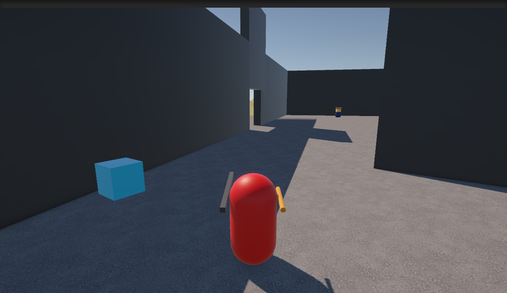
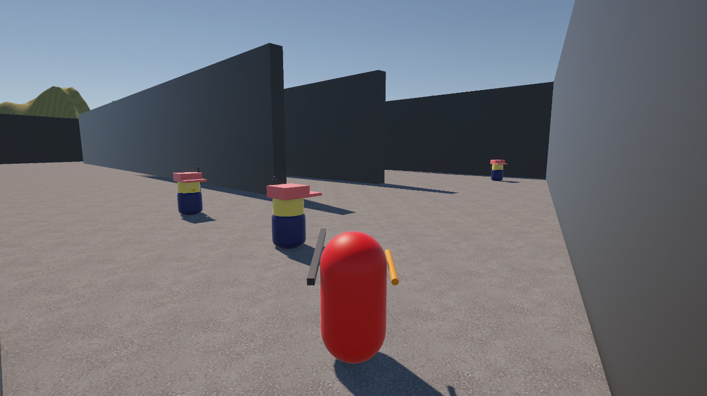

# Infiltración a la Instalación

## Desarrollador

- Nombre: Mateo
- Apellido: Carrizo
- LU: TUV000877

---

# Descripción del Juego

"Infiltración a la Instalación" es un prototipo desarrollado en Unity donde el jugador debe recorrer una instalación hostil mientras evita o enfrenta enemigos controlados mediante inteligencia artificial.

Durante la exploración, el jugador puede interactuar con botones para abrir puertas, recolectar objetos para obtener puntos y utilizar herramientas especiales para facilitar su avance. La partida puede completarse eliminando 5 enemigos del escenario o alcanzando la cantidad de puntos requerida para obtener la victoria (60).

---

# Guía de Controles

| Acción | Tecla |
|----------|----------|
| Moverse | W A S D |
| Saltar | Espacio |
| Interactuar | E |
| Ataque principal | Click Izquierdo |
| Pistola Aturdidora | Click Derecho |
| Pausa | P |

---

# Sistemas Implementados

## Interacción a Distancia

Se implementó un sistema de interacción mediante Raycast frontal desde el jugador.

Permite:

- Activar botones.
- Recolectar objetos.

### Scripts utilizados

- `PlayerInteraction.cs`
- `ButtonInteraction.cs`
- `DoorController.cs`
- `Collectible.cs`

---

# Opcionales Elegidos

## Opción 1: Pistola Aturdidora

Se implementó un arma especial que utiliza Raycast para detectar enemigos.

Cuando impacta a un enemigo:

- Lo paraliza temporalmente.
- Detiene su movimiento.
- Cancela temporalmente su comportamiento de persecución.

### Scripts utilizados

- `StunGun.cs`
- `EnemyAI.cs`
- `EnemyAIGenerated.cs`

---

## Opción 2: Power-Up de Invisibilidad

Se implementó un ítem recolectable que vuelve al jugador indetectable por la IA durante un tiempo limitado.

Mientras el efecto permanece activo:

- Los enemigos dejan de perseguir al jugador.
- Regresan al estado de patrullaje.

### Scripts utilizados

- `InvisibilityPowerUp.cs`
- `PlayerStealth.cs`
- `EnemyAI.cs`
- `EnemyAIGenerated.cs`

---

## Opción 3: Generación de Enemigos

Se implementó un sistema de generación periódica de enemigos utilizando prefabs.

Los enemigos creados dinámicamente:

- Utilizan NavMeshAgent.
- Patrullan el escenario.
- Detectan al jugador.
- Pueden ser aturdidos y eliminados.

### Scripts utilizados

- `GeneradorBehavior.cs`
- `EnemyAIGenerated.cs`

---

# Capturas del Proyecto

Agregar imagen mostrando interacción, IA o power-ups.

---

# Tecnologías Utilizadas

- Unity
- C#
- NavMesh
- Raycast
- Corrutinas
- Sistema de Estados
- Prefabs
- Git y GitHub

---

# Repositorio

https://github.com/WSky6/TP02-PV1-CarrizoMateo